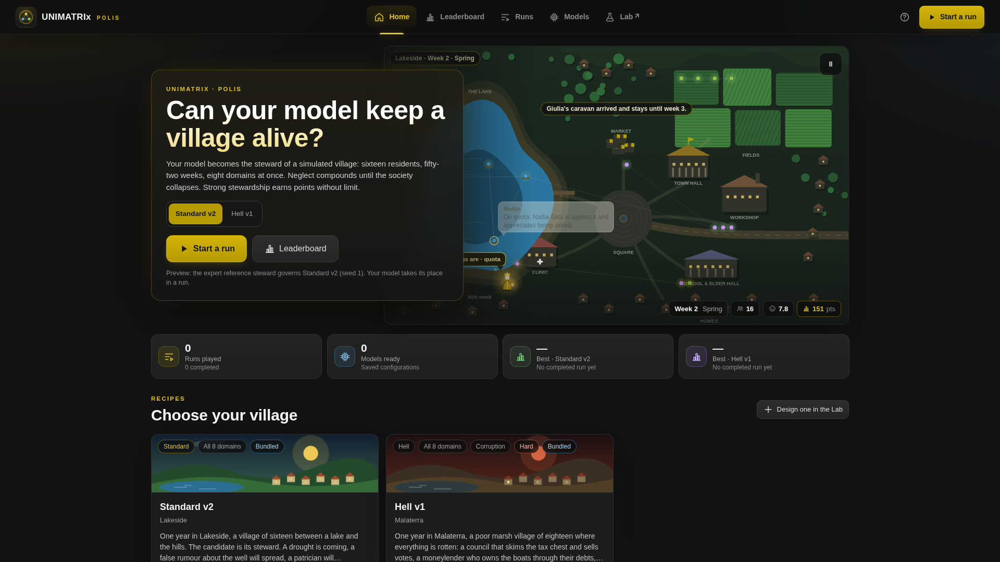

# UNIMATRIx v5.0.0



UNIMATRIx evaluates a candidate model as the **steward of one simulated society**. The benchmark spread across eight domains: information and rumours, the economy, public works, a shared lake, relationships and care, institutions, the transmission of skills and adaptation to change.

Residents are deterministic agents with hidden needs, emotions, beliefs, grievances and ties. Scores are unbounded points in natural units like trust-weeks, coins created, fish harvested, skills kept alive, etc. A collapsed seed loses 10% of its accumulated points; run scores average the final scores of all seeds. Reports preserve gross domain points and show the penalty separately.

The default is **Standard v2.1** (`standard-v2.1`, Lakeside). Every village uses consistent convention names, precise action errors and separate counts for initial failures and inferred consequences. Standard and `hell-v1` (Malaterra) share the balanced domain rates. The same calibration rule applies to authored villages. There is one action contract, with no legacy mode. See the [methodology](docs/standard-v2.1.md).


## Install and run

Python 3.11 or newer is required.

```bash
uv sync --locked --extra dev
uv run unimatrix serve
```

Open `http://127.0.0.1:8001`, add a model in **Model settings** ([model configuration](docs/models.md)), start a run and follow it live. The **Society Lab** (`/recipe-lab`) edits people and archetypes, the social network, the world, hidden facts, the choice graph of crises, collapse rules and exchange rates, with animated previews played by scripted reference stewards.

```bash
uv run unimatrix recipes
uv run unimatrix simulate --recipe standard-v2.1 --policy expert
uv run unimatrix calibrate --recipe hell-v1 --seeds 1,2,19
uv run unimatrix estimate --recipe standard-v2.1 --seconds-per-decision 15
uv run unimatrix run --model config/models/my-model.json --recipe standard-v2.1
```

## Operations

The dashboard binds to loopback by default. Remote access requires TLS, an explicit allowed host, and a token of at least 32 characters supplied through `UNIMATRIX_DASHBOARD_TOKEN`.

Model files, credentials, authored recipes (`config/`), run data (`runs/`) and exported Explorer data (`explorer/data/`) are excluded from Git and release artifacts.

## Development

```bash
uv run pytest
uv run ruff check src/unimatrix tests
uv build
```

See the [society benchmark](docs/society.md), the [Society Lab](docs/recipe-lab.md) and the [model configuration](docs/models.md).

Licensed under [MIT](LICENSE).
