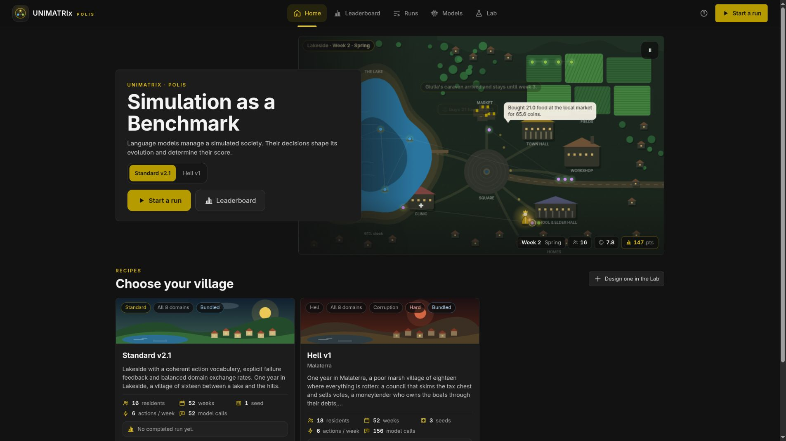

# UNIMATRIx v5.0.0



UNIMATRIx evaluates a candidate model as the **steward of one simulated society**. The benchmark spans eight connected domains: information and rumours, the economy, public works, shared resources, relationships and care, institutions, the transmission of skills and adaptation to change.

Residents are deterministic agents with hidden needs, emotions, beliefs, grievances and ties. Scores are unbounded points in natural units like trust-weeks, coins created, fish harvested, skills kept alive, etc. A collapsed seed loses 10% of its accumulated points; run scores average the final scores of all seeds. Reports preserve gross domain points and show the penalty separately.

Each week, the model receives a partial view of the community and chooses a limited set of actions. Residents react, resources change and events unfold. Decisions have lasting effects across domains: providing relief, enforcing a policy or preserving a skill can change both immediate welfare and the society's ability to withstand later crises.

## Install and run

Python 3.11 or newer is required.

```bash
uv sync --locked --extra dev
uv run unimatrix serve
```

Open `http://127.0.0.1:8001`, add a model in **Model settings** ([model configuration](docs/models.md)), start a run and follow it live. The **Society Lab** (`/recipe-lab`) edits people and archetypes, the social network, the world, hidden facts, the choice graph of crises, collapse rules and exchange rates, with animated previews played by scripted reference stewards.

```bash
uv run unimatrix simulate --policy expert
uv run unimatrix calibrate --seeds 1,2,3,4,5
uv run unimatrix estimate --seconds-per-decision 15
uv run unimatrix run --model config/models/my-model.json
```

## Operations

The dashboard binds to loopback by default. Remote access requires TLS, an explicit allowed host, and a token of at least 32 characters supplied through `UNIMATRIX_DASHBOARD_TOKEN`.

Model files, credentials, saved society configurations (`config/`), run data (`runs/`) and exported Explorer data (`explorer/data/`) are excluded from Git and release artifacts.

## Documentation

- [Simulation concept and mechanics](docs/society.md)
- [Society Lab: design, preview and calibration](docs/society-lab.md)
- [Model configuration](docs/models.md)
- [Standard v2.1: concept and design decisions](docs/recipes/standard-v2.1.md)
- [Hell v1: concept and design decisions](docs/recipes/hell-v1.md)
- [Explorer: replay and publishing](explorer/README.md)

## Development

```bash
uv run pytest
uv run ruff check src/unimatrix tests
uv build
```

Licensed under [MIT](LICENSE).
